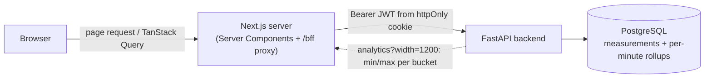
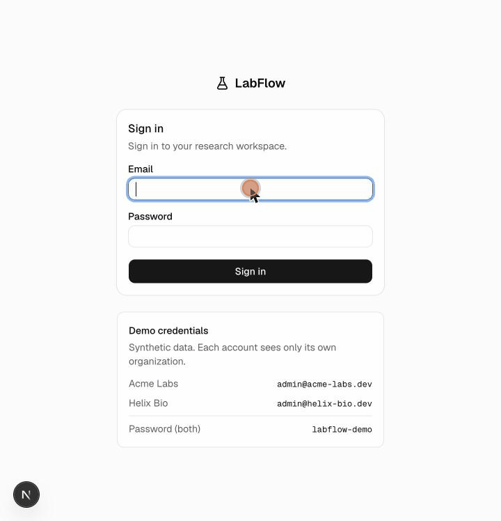

# LabFlow

A multi-tenant workflow and analytics platform for research teams. Organizations
manage projects, projects contain experiments, experiments hold samples, and samples
accumulate time-series measurements that get charted on an analytics page.

```
Organization -> Projects -> Experiments -> Samples -> Measurements
```

Two demo organizations, three users each, and roughly 11,000 synthetic measurement
readings are loaded by the seed script (see [Demo data](#demo-data)).

## Stack

**Frontend:** Next.js (App Router), React, TypeScript (strict), TanStack Query,
Tailwind CSS, shadcn/ui + Radix primitives, React Hook Form + Zod, Recharts, Vitest +
React Testing Library, Playwright.

**Backend:** FastAPI, Pydantic v2, SQLAlchemy 2, psycopg3, Alembic, PyJWT, bcrypt,
pytest, Ruff.

**Infra:** PostgreSQL 17, Docker Compose.

## Architecture



Three containers: `postgres`, `backend`, `frontend`. The backend is a normal FastAPI
REST API; it doesn't know the frontend exists. The frontend is a Next.js server that
does two things at once: it renders pages (Server Components fetch directly from the
backend using the session's bearer token) and it exposes a small BFF (backend-for-
frontend) route at `/bff/api/*` that client components call instead of hitting the
backend directly.

The reason for the BFF: the backend issues a JWT, and that JWT is kept in an `httpOnly`
cookie set by a Server Action after login (`frontend/src/app/login/actions.ts`), so
client-side JavaScript never has access to it. When a Client Component needs data
(`browserApi` in `frontend/src/lib/api/browser.ts`), it calls `/bff/api/...` on the
Next.js server itself; the route handler at `frontend/src/app/bff/[...path]/route.ts`
reads the cookie, attaches `Authorization: Bearer <token>`, and forwards the request to
the backend. It only forwards `/api/...` paths (`.` and `..` segments are rejected so a
crafted path can't be normalised out of `/api`), and it gives the backend 15 seconds
before answering `504`. This keeps the token out of the browser's JavaScript context while still
letting client components own their own data fetching through TanStack Query.

Server Components fetch with the token directly (`frontend/src/lib/api/server.ts`,
`getServerApi`) since they run on the server anyway, so there's no BFF hop needed for
the initial render. A middleware (`frontend/src/proxy.ts`) does an optimistic redirect
to `/login` when there's no valid session cookie; the backend independently verifies
the JWT on every request regardless of what the middleware does, since the middleware
is a UX shortcut, not the security boundary.

### Server vs Client Components

Pages and layouts that only need to display data owned by the backend (the dashboard,
the app shell, project/experiment detail shells) are Server Components: they fetch
once per request and there's nothing for the client to own. Anything interactive
(filters, forms, dialogs, the analytics chart controls) is a Client Component using
TanStack Query, hydrated from the server's prefetch via `frontend/src/components/
hydrate.tsx` so the first paint already has data instead of a loading skeleton.

### Typed API client

`frontend/src/lib/api/schema.d.ts` is generated from the backend's live OpenAPI schema
with `openapi-typescript` (`npm run gen:api`, backend must be running). Request and
response types for every endpoint come from that generated file through `openapi-
fetch` (`frontend/src/lib/api/client.ts`), so a backend schema change that isn't
matched on the frontend fails `tsc`, not a runtime bug.

## Multi-tenant isolation

Every table that belongs to an organization is scoped through `backend/app/tenancy.py`.
There's no separate "check the org_id" step after loading a row: the org filter is
part of the SQL query itself, joined up to `projects.org_id` for experiments, samples,
and measurements. A request for a resource in another organization returns `404`, not
`403`. A `403` would confirm the ID exists and just isn't yours, which leaks
information about other tenants.

`backend/tests/test_tenant_isolation.py` checks this from several angles: reading and
modifying another org's experiment, listing only returns your own org's rows,
assigning an experiment owner from another org is rejected, and the analytics endpoint
rejects sample IDs that belong to another org's data. While building this, the org
filter was deliberately removed from `tenancy.py` to confirm those tests actually fail
without it (they did, six of them), then restored, so the tests are known to test
something real rather than trivially passing.

The Playwright suite adds a browser-level version of the same check: an Acme Labs user
navigating directly to a Helix Biosciences project URL gets the app's not-found page,
never the other org's data.

## Testing

Three layers. pytest runs against a real Postgres database and Playwright against the
full running stack; the Vitest suite stubs `fetch` and runs offline:

| Layer | Tool | Count | Run with |
|---|---|---|---|
| Backend | pytest | 54 tests | `cd backend && pytest` |
| Frontend unit | Vitest | 87 tests | `cd frontend && npm test` |
| End-to-end | Playwright | 4 tests | `cd frontend && npm run test:e2e` (stack must be running) |

Backend tests run against a real `labflow_test` database, migrated fresh with Alembic
and truncated between tests, not an in-memory substitute. Playwright tests hit
`http://localhost:3000`, which talks to the real backend and Postgres through the same
BFF path a real user's browser would use, and cover:

- **Golden path:** sign in, open a project, create an experiment, add a sample, record
  a measurement, see it charted on the analytics page, edit the experiment.
- **Failure paths:** wrong password shows an error and sets no session cookie; an
  empty required field is rejected client-side before any request is sent; guessing
  another organization's project ID by URL returns not-found.

CI (`.github/workflows/ci.yml`) runs on every push and pull request: Ruff (lint and
format check) and pytest against a Postgres 17 service container for the backend, and
ESLint, `tsc`, Vitest and `next build` for the frontend. Playwright needs the whole
compose stack and is not part of CI.

## Performance

The expensive path is the experiment analytics endpoint: one chart can span hundreds of
thousands of readings. Changes on this branch:

- Composite time indexes on `measurements` (migration `0002`).
- Per-minute rollups (`measurement_rollups`) maintained by a statement-level trigger (migration `0003`).
- `GET /api/experiments/{id}/analytics?width=N` splits each series into `N` time buckets and
  returns the lowest and highest reading of each (at most `2 x N` points per series), computed in
  SQL (`backend/app/analytics.py`). The frontend requests `width=1200` for charts.
- The analytics queries read `measurements` by `sample_id` directly (the experiment was already
  resolved through the org-scoped lookup) instead of joining every row back up to `projects.org_id`.

### Results

Dataset: 1 experiment, 4 samples x 2 metrics x 50,000 readings = **400,000 measurements** (`bench.seed_scale --points 50000`).
Latency is sequential HTTP requests to a running uvicorn (12 repeats for light cases, 3 for analytics; one warm-up),
p50 / p95 in ms; payload is the JSON response body. Environment: Apple M1, 8 GiB, macOS 26.2, Python 3.14.8,
PostgreSQL 16.2 on the same machine (no Docker), **machine not idle (load average 3-5)**, so treat absolute numbers as noisy.
Before = `main` (9ffa4ef); after = this branch with `width=1200`. Run 1 shown; run 2 is in the same directory and agrees in direction
(for example whole experiment 4337 ms -> 824 ms).

| Case | Before p50 / p95 | Before payload | After p50 / p95 | After payload |
|---|---|---|---|---|
| dashboard | 189 / 190 | 3.9 KiB | 52 / 53 | 3.9 KiB |
| samples list (with counts) | 109 / 110 | 0.9 KiB | 42 / 44 | 0.9 KiB |
| measurements page 1 | 82 / 84 | 9.5 KiB | 26 / 27 | 9.5 KiB |
| analytics, 1 series (50k points) | 522 / 555 | 3,087 KiB | 93 / 105 | 149 KiB |
| analytics, 1 metric, 4 samples | 1,735 / 1,771 | 12,347 KiB | 520 / 556 | 594 KiB |
| analytics, whole experiment | 3,774 / 3,906 | 24,787 KiB | 688 / 856 | 1,192 KiB |

Payload shrinks about 21x for the 50k-point series because the response is capped at 2400 points per series.
Without `width` the branch still reads faster than `main` but returns full resolution (`after-nowidth-50k.json`:
whole experiment 3,548 ms, 24,787 KiB), so most of the latency win on the largest case comes from downsampling.
Larger scales (125,000 readings per series, from an earlier run on a different laptop, environment not recorded) are
kept under `backend/bench/results/` but not quoted because those runs disagreed with each other by 2-3x.
Not measured: browser render time, concurrent load, Docker Compose, Postgres 17 (the compose stack's version).

### Reproduce

```bash
cd backend
# DATABASE_URL pointing at a migrated database (alembic upgrade head)
python -m bench.seed_scale --points 50000 --reset      # bench@labflow.dev / labflow-demo
uvicorn app.main:app --port 8000 &
python -m bench.bench_api --label after --query width=1200 --note "my machine"
```

For the "before" numbers, check out `main`, copy `backend/bench/` over, migrate a separate database, seed the same way and run
`bench_api` without `--query`. Each result JSON stores its command and environment. See `backend/bench/results/README.md`.

## Data model

- **Organization**: the tenant boundary. Has users and projects.
- **User**: belongs to exactly one organization, has a role (`admin` or `member`).
- **Project**: belongs to an organization, groups experiments.
- **Experiment**: belongs to a project, has an owner (a user), a status (`planned`,
  `running`, `completed`, `archived`), and optional start/end dates.
- **Sample**: belongs to an experiment, has a type and a status.
- **Measurement**: belongs to a sample: a timestamp, a metric name, a numeric value,
  and a unit. This is the time series that gets charted.

Archiving an experiment is a status change, not a delete: samples and measurement
history are kept.

## Running it locally

```bash
cp .env.example .env
# edit .env: set POSTGRES_PASSWORD and JWT_SECRET (see the comments in .env.example)

docker compose up --build
```

The backend refuses to start while `JWT_SECRET` is still the `.env.example` placeholder: that
value is public, so anyone could sign a valid token with it. `GET /health` returns `503` when
the database is unreachable, which is what the compose healthcheck polls.

This starts Postgres, runs the Alembic migration, seeds the demo data (controlled by
`SEED_DEMO_DATA` in `.env`), and starts the backend and frontend. Once all three
services report healthy:

- Frontend: http://localhost:3000
- Backend docs: http://localhost:8000/docs

### Demo data

`backend/scripts/seed.py` creates two organizations with entirely synthetic data:

- **Acme Labs**: catalyst screening, polymer curing, and solvent recovery projects.
- **Helix Biosciences**: a fermentation scale-up project.

Every seeded user shares the password `labflow-demo` (e.g. `admin@acme-labs.dev`,
`admin@helix-bio.dev`). Measurement time series aren't random noise: each metric
follows a real-looking shape (temperature drift, an exponential decay, a logistic
growth curve, and so on) with Gaussian noise layered on top, so the analytics charts
have something to show.

Re-run the seed against a running stack with:

```bash
docker compose exec backend python -m scripts.seed --reset
```

### Large-data demo

To see an experiment with many measurements load quickly (800,000 readings by default):

```bash
./demo.sh        # generates .env if missing, docker compose up --build -d --wait, loads the bench tenant
```

Then open http://localhost:3000, sign in as `bench@labflow.dev` / `labflow-demo`, open the project's
experiment and its Analytics tab. `POINTS=25000 ./demo.sh` uses a smaller set. On an 8 GB Mac keep Docker's memory
limit around 3-4 GB. The demo script has not been run inside Docker by the author of this change (no container
runtime was available); the same data load was exercised against a local PostgreSQL.

### Running tests

```bash
# Backend (needs the compose Postgres, or point DATABASE_URL/TEST_DATABASE_URL
# at your own instance)
cd backend
python -m venv .venv && source .venv/bin/activate
pip install -r requirements.txt -r requirements-dev.txt
pytest

# Frontend unit tests (no running backend required, they don't hit the network)
cd frontend
npm install
npm test

# End-to-end (needs the full stack running: docker compose up)
npm run test:e2e
```

### Regenerating frontend API types

If the backend's schema changes, regenerate the frontend's types from the live OpenAPI
document:

```bash
cd frontend
API_SCHEMA_URL=http://localhost:8000/openapi.json npm run gen:api
```

## Known limitations

This is a portfolio-scale project, not a production system. Deliberately out of scope:

- No rate limiting or brute-force protection on login.
- No email verification, password reset, or account recovery flow.
- No role-based permission checks beyond org membership (`admin` vs `member` is stored
  but not yet enforced anywhere).
- No real-time updates; TanStack Query's cache invalidation after a mutation is what
  keeps the UI current, not a websocket or polling.
- The JWT has no refresh flow: it's a 12-hour token, and expiry redirects to login.
- Measurement ingestion is a single-row `POST`; there's no bulk/CSV import.
- Downsampling keeps each bucket's min and max, so charts show extremes faithfully but not every point.
- Rollups are maintained by an insert trigger; updates and deletes of measurements are not reflected in them.
- Benchmarks are single-client, on one machine, on a non-idle laptop; see the Performance section.
- Seed data is synthetic and small enough to run comfortably in a laptop-sized
  Postgres instance; it isn't representative of production data volumes.

## Demo



*Sign in to the large demo tenant (400,000 measurements), open the experiment's Analytics tab: each series is downsampled server-side (min/max buckets) so the charts load 19,200 points instead of 400,000.*
